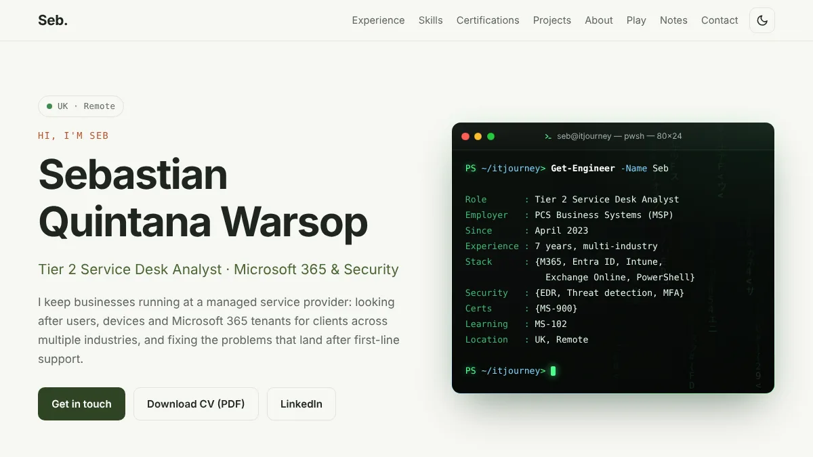

# ITJourney

My personal site and CV: Sebastian Quintana Warsop, Tier 2 Service Desk Analyst.

Live at [sebqw.github.io/ITJourney](https://sebqw.github.io/ITJourney/)

## What's here

- `index.html`: the main page (about, experience, skills, qualifications, projects, contact)
- `project.html`: the story of **FOV CRM**, the client management app from my IT apprenticeship (C# Windows Forms) and its 2.0 rebuild
- `crm/`: **FOV CRM 2.0**, the rebuilt app, running live in the browser with demo data
- `notes/`: my documentation hub, including MS-102 revision flashcards (`notes/ms102-cards.js` holds the cards)
- `CSS/styles.css`: all styling
- `js/site.js`: shared behaviour (phone menu, light/dark switch, scroll effects)
- `js/slideshow.js`: the project image slideshow
- `js/packet-run.js`: Packet Run, the small game on the home page
- `images/`: WebP images used by the site

## Running it

It's plain HTML, CSS and JavaScript with no build step. Open `index.html` in a browser.

The site is published to GitHub Pages by the workflow in `.github/workflows/deploy-pages.yml`.
